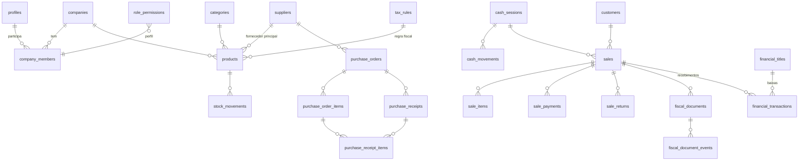

# Arquitetura do ERP

Documento de referência da Etapa 1. Descreve a arquitetura, a estrutura de
pastas, a modelagem do banco, os fluxos entre módulos, a estratégia de
segurança, o plano de etapas e as integrações externas necessárias.

> **Status:** o banco de dados, as permissões e as regras de negócio críticas
> (estoque, compras, PDV, caixa, cancelamento, contas a pagar/receber) estão
> implementados e testados. As telas começam na Etapa 2. **O sistema ainda não
> está pronto para produção.**

---

## 1. Arquitetura proposta

```
┌──────────────────────────── Navegador ────────────────────────────┐
│  Next.js (React 19, Tailwind, shadcn/ui)                          │
│  Client Components: PDV, formulários, tabelas                     │
│  Supabase JS (chave publicável + sessão do usuário)               │
└───────────────┬───────────────────────────────────────┬───────────┘
                │ Server Actions / Route Handlers        │ leituras com RLS
┌───────────────▼─────────────── Vercel ─────────────────┼───────────┐
│  Next.js 16 (App Router, TypeScript)                   │           │
│  • Validação Zod (src/lib/validation)                  │           │
│  • Serviços por módulo (src/modules/*)                 │           │
│  • Geração de PDF (servidor)                           │           │
│  • Integração fiscal (servidor, chave secreta)  ───────┼──► Provedor fiscal
└───────────────┬────────────────────────────────────────┼───────────┘   (NF-e/NFC-e)
                │ PostgREST / RPC                        │
┌───────────────▼────────────── Supabase ────────────────▼───────────┐
│  Auth (e-mail/senha, convites)   Storage (logos, PDFs, XML)        │
│  PostgreSQL                                                        │
│   • Tabelas com company_id + RLS                                   │
│   • Funções transacionais (finalize_sale, receive_purchase, …)     │
│   • Triggers de integridade, numeração e auditoria                 │
└────────────────────────────────────────────────────────────────────┘
```

Princípios:

1. **O banco é a última linha de defesa.** Toda regra crítica (saldo de
   estoque, transições de status, permissões, duplicidade) é garantida no
   PostgreSQL, não apenas na interface. O frontend repete as validações só
   para dar respostas rápidas.
2. **Operações críticas em uma única transação.** Finalizar venda, receber
   mercadorias, cancelar venda e fechar inventário são funções SQL
   (`SECURITY DEFINER`) que validam a permissão e gravam tudo ou nada.
3. **Idempotência.** Venda e recebimento exigem uma chave gerada pelo
   cliente (`idempotency_key`). Reenvios (duplo clique, rede instável)
   devolvem o mesmo registro em vez de lançar de novo.
4. **Multiempresa desde o início.** Toda tabela de negócio tem `company_id`;
   o RLS isola os dados por vínculo do usuário (`company_members`).
5. **Imutabilidade do histórico.** Movimentações de estoque e lançamentos
   financeiros não são editados nem apagados: correções viram novos
   lançamentos (estorno, ajuste).

---

## 2. Estrutura de pastas

```
.
├── docs/ARQUITETURA.md          ← este documento
├── supabase/migrations/         ← schema versionado (aplicar em ordem)
│   ├── …0100_core.sql           empresas, usuários, permissões, numeração, auditoria
│   ├── …0200_cadastros.sql      categorias, regras tributárias, fornecedores, clientes, produtos
│   ├── …0300_estoque_compras.sql movimentações, inventário, pedidos, recebimentos
│   ├── …0400_vendas_caixa.sql   caixa, vendas, itens, pagamentos, devoluções
│   ├── …0500_financeiro.sql     categorias, contas a pagar/receber, lançamentos
│   ├── …0600_fiscal_documentos.sql configuração fiscal, NF-e/NFC-e, PDFs gerados
│   ├── …0700_rls.sql            políticas de acesso
│   ├── …0800_storage.sql        buckets e políticas de arquivos
│   └── …0900_rpc_operacoes.sql  funções transacionais
├── tests/db/                    ← testes SQL (rodam em PostgreSQL temporário)
├── scripts/test-db.sh
├── src/
│   ├── app/                     ← rotas (App Router)
│   │   ├── (auth)/              login, convite, recuperação de senha      [Etapa 2]
│   │   └── (erp)/               layout com menu lateral                    [Etapa 2]
│   │       ├── dashboard/  produtos/  estoque/  clientes/  fornecedores/
│   │       ├── compras/  pdv/  vendas/  fiscal/  financeiro/
│   │       └── relatorios/  configuracoes/
│   ├── components/
│   │   ├── ui/                  componentes shadcn/ui                     [Etapa 2]
│   │   └── shared/              tabela de dados, filtros, diálogos        [Etapa 2]
│   ├── modules/<módulo>/        actions.ts, queries.ts, components/       [Etapas 3+]
│   ├── lib/
│   │   ├── auth/permissions.ts  matriz de permissões (espelho do banco)
│   │   ├── domain/              regras puras (dinheiro, cálculo de venda)
│   │   ├── validation/          CPF/CNPJ e schemas Zod
│   │   ├── supabase/            clientes (navegador, servidor, admin)
│   │   ├── env.ts / env.server.ts
│   │   ├── pdf/                 geração de documentos                     [Etapa 4]
│   │   └── fiscal/              adaptadores de provedores                 [Etapa 6]
│   └── proxy.ts                 renovação de sessão (Next 16)              [Etapa 2]
└── .env.example
```

---

## 3. Modelagem do banco de dados

### 3.1 Diagrama (entidades principais)



### 3.2 Tabelas

| Domínio | Tabela | Observações |
|---|---|---|
| Núcleo | `companies` | Dados cadastrais, parâmetros (estoque negativo, limite de desconto do vendedor, prazo do cartão). |
| | `profiles` | 1:1 com `auth.users`, criado por trigger. |
| | `company_members` | Usuário × empresa × perfil (`admin`, `manager`, `seller`, `stockist`). Sempre há ≥ 1 admin ativo. |
| | `role_permissions` | Permissões de cada perfil (ex.: `sales.cancel`). |
| | `company_counters` | Numeração sequencial por empresa (produto, pedido, venda…). |
| | `audit_logs` | Alterações de cadastros (trigger) e eventos de operações (RPC). |
| Cadastros | `categories`, `tax_rules` | Regras tributárias: CFOP, CST/CSOSN, alíquotas, `extra` para IBS/CBS/FCP/ST. |
| | `suppliers`, `supplier_products` | Fornecedor e produtos fornecidos (com último custo). |
| | `customers` | PF/PJ; documento opcional (consumidor não identificado). |
| | `products` | Código interno automático, código de barras único, preços, margem calculada, saldo, mínimo, dados fiscais. |
| Estoque | `stock_movements` | Imutável; saldo antes/depois, usuário, motivo e referência à operação. |
| | `inventory_counts`, `inventory_count_items` | Inventário físico; o fechamento gera ajustes. |
| Compras | `purchase_orders`, `purchase_order_items` | Status: rascunho → enviado → confirmado → parcialmente recebido → recebido / cancelado. |
| | `purchase_receipts`, `purchase_receipt_items` | Recebimentos parciais com NF do fornecedor e idempotência. |
| Caixa | `cash_sessions`, `cash_movements` | Abertura, venda em dinheiro, sangria, suprimento, estorno, fechamento com diferença. |
| Vendas | `sales`, `sale_items`, `sale_payments` | Número único, snapshot de nome e custo do item, pagamento misto com troco. |
| | `sale_returns`, `sale_return_items` | Devoluções (fluxo na Etapa 5). |
| Financeiro | `financial_categories` | Categorias padrão criadas para cada empresa. |
| | `financial_titles` | Contas a pagar/receber; unicidade por origem impede duplicidade. |
| | `financial_transactions` | Fluxo de caixa realizado; correções por estorno (`reversal_of`). |
| Fiscal | `fiscal_settings` | Provedor, ambiente, regime, séries e numeração, CSC id. |
| | `private.fiscal_secrets` | Token do provedor, CSC e senha do certificado **criptografados**; inacessível pela API. |
| | `fiscal_documents`, `fiscal_document_events` | Chave de acesso, protocolo, XML/DANFE, rejeições e histórico de chamadas. |
| Documentos | `generated_documents` | PDFs gerados e seus caminhos no Storage. |

Convenções: valores monetários `numeric(14,2)`, custos `numeric(14,4)`,
quantidades `numeric(14,3)` (aceita KG, L, M). Chaves estrangeiras com
`restrict` onde há histórico; índices para buscas por empresa, data, status e
nome (trigram, para pesquisa parcial).

### 3.3 Regras garantidas pelo banco

- Saldo de estoque **só muda por movimentação** (trigger bloqueia alteração direta).
- Estoque negativo bloqueado, salvo `companies.allow_negative_stock`.
- Código interno e números de documentos gerados pelo sistema e imutáveis.
- Referências sempre da mesma empresa (trigger `tg_check_company_refs`).
- CPF/CNPJ válidos (inclusive CNPJ alfanumérico) por `CHECK`.
- Pedido de compra: itens e valores editáveis só em rascunho/enviado;
  transições de status validadas; "recebido" só via recebimento.
- Recebimento não excede o saldo pendente de cada item.
- Venda: preço vem do cadastro; soma dos pagamentos = total; troco só em
  dinheiro; desconto acima do limite exige `sales.discount_unlimited`;
  crediário exige cliente.
- Venda só é cancelada sem documento fiscal ativo e sem parcelas recebidas.
- Títulos financeiros: baixa somente pela função `settle_title`; títulos
  automáticos não têm valor/origem alterados.

---

## 4. Fluxos entre os módulos

### 4.1 Compras → Estoque → Financeiro

```
Pedido (rascunho) ──enviar──► enviado ──confirmar──► confirmado
        │                                                │
        └────────────── PDF do pedido (Etapa 4) ─────────┘
                                                          │ receive_purchase()
                                                          ▼
                      ┌───────── para cada item recebido ─────────┐
                      │ received_quantity += qtd                  │
                      │ custo médio ponderado do produto          │
                      │ stock_movements (+qtd, purchase_receipt)  │
                      │ supplier_products.last_cost               │
                      └───────────────────────────────────────────┘
                                                          │
                       status: parcialmente recebido / recebido
                                                          │
             conta a pagar = mercadorias recebidas + rateio de frete/desconto
             (a soma de todos os recebimentos fecha no total do pedido)
```

O estoque **só aumenta na confirmação do recebimento**. Reenvio com a mesma
chave devolve o recebimento existente, sem lançar de novo.

### 4.2 Venda (PDV) → Estoque → Caixa/Financeiro → Fiscal

```
Abrir caixa ─► montar carrinho ─► pagamentos ─► finalize_sale()  (1 transação)
                                                   │
       ┌───────────────────────────────────────────┼─────────────────────────┐
       ▼                                           ▼                         ▼
 sales + sale_items                     stock_movements (−qtd)    Pagamentos:
 (rateio do desconto geral)             bloqueia se sem estoque    • dinheiro → lançamento + gaveta
                                                                   • Pix/débito/transferência → lançamento
                                                                   • crédito → conta a receber (D+N)
                                                                   • crediário → N contas a receber
                                                   │
                                                   ▼
                       Comprovante (não fiscal, identificado como tal)
                                                   │
                         Emissão fiscal conforme configuração (Etapa 6):
             pending → processing → authorized | rejected | denied | contingency
```

**Cancelamento:** se houver NFC-e/NF-e autorizada, primeiro cancela-se o
documento no provedor (dentro do prazo legal); depois `cancel_sale()` devolve
o estoque, estorna os recebimentos, cancela as contas a receber e registra a
saída do dinheiro no caixa aberto de quem cancelou.

### 4.3 Emissão fiscal (Etapa 6)

1. Identificar o modelo aplicável (NFC-e para consumidor final presencial;
   NF-e quando há destinatário PJ/contribuinte ou operação que a exija). A
   regra é configurável e **não presume** que toda venda pode emitir qualquer
   documento.
2. Carregar emitente (`companies` + `fiscal_settings`), destinatário e itens
   (NCM, CEST, origem, `tax_rules`).
3. Validar campos obrigatórios antes de enviar (erros exibidos ao usuário).
4. Reservar o número (série/numeração) e criar `fiscal_documents` com
   `provider_reference` único (idempotência no provedor).
5. Enviar ao provedor pelo servidor; registrar cada chamada em
   `fiscal_document_events` (sem segredos).
6. Consultar o retorno (webhook do provedor ou polling) e gravar chave de
   acesso, protocolo, status, XML e DANFE no bucket `fiscal`.
7. Tratar rejeições (corrigir e reenviar), denegação, cancelamento,
   inutilização de numeração e contingência conforme o modelo.

---

## 5. Estratégia de segurança

| Camada | Medida |
|---|---|
| Autenticação | Supabase Auth (e-mail/senha; convites pelo administrador). Sessão em cookie httpOnly gerenciado por `@supabase/ssr`; renovação no `proxy.ts`. |
| Autorização | Perfis → permissões em `role_permissions`. Verificadas **no banco** (RLS e `app.require_permission` nas funções) e repetidas no servidor para mensagens melhores. Botões ocultos são apenas conveniência. |
| Isolamento | RLS em todas as tabelas de `public`; `anon` sem acesso; leitura exige vínculo ativo com a empresa. |
| Escritas críticas | Tabelas operacionais sem privilégio de escrita para `authenticated`; somente funções `SECURITY DEFINER` com `search_path` vazio. As travas de sistema usam `current_user`, que o cliente não consegue forjar. |
| Segredos | Chave secreta do Supabase e chaves do provedor fiscal só no servidor (`server-only`). Credenciais fiscais criptografadas (AES-256-GCM) em `private.fiscal_secrets`, schema não exposto. |
| Arquivos | Buckets privados; caminho `<company_id>/…`; acesso por URL assinada de curta duração. Arquivos fiscais gravados apenas pelo servidor. |
| Duplicidade | Chaves de idempotência (venda, recebimento, devolução), unicidade de títulos por origem, um caixa aberto por operador, um documento fiscal ativo por venda/modelo. |
| Auditoria | `audit_logs` com usuário, ação, dados antes/depois (cadastros e configurações) e eventos das operações. |
| LGPD | Coleta mínima (documento do cliente opcional), acesso restrito por perfil, logs de acesso a dados sensíveis, rotina de anonimização de clientes a pedido do titular (Etapa 7), retenção fiscal respeitada (documentos fiscais não são apagados). |
| Aplicação | Validação Zod em todas as Server Actions; erros do banco traduzidos para mensagens amigáveis; cabeçalhos de segurança (CSP) na Etapa 8. |

---

## 6. Plano de desenvolvimento

| Etapa | Entregas | Situação |
|---|---|---|
| 1 — Arquitetura | Este documento, migrations completas, RLS, funções transacionais, matriz de permissões, validações (CPF/CNPJ, Zod), cálculos de venda, testes SQL e unitários, CI. | **Concluída** |
| 2 — Fundação | Login, convite e recuperação de senha; onboarding da empresa; `proxy.ts`; layout com menu lateral recolhível; tema claro/escuro; shadcn/ui; dashboard com indicadores e filtro de período; gestão de usuários. | Próxima |
| 3 — Cadastros | Produtos (imagem, dados fiscais, importação/exportação CSV/XLSX), clientes (histórico, total gasto), fornecedores, categorias; consulta de CEP. | |
| 4 — Estoque e compras | Movimentações, alertas de mínimo, inventário, pedidos de compra com PDF A4, recebimento parcial, relatório de estoque (PDF/Excel). | |
| 5 — Vendas | PDV com leitor de código de barras, pagamento misto e troco, caixa, comprovante, cancelamento e devolução, orçamento comercial. | |
| 6 — Fiscal | Configuração fiscal e regras tributárias; integração com o provedor escolhido em **homologação**; DANFE/DANFE NFC-e; cancelamento, rejeições, contingência. | |
| 7 — Financeiro e relatórios | Contas a pagar/receber, baixas, fluxo de caixa, lucro bruto, faturamento, relatórios PDF/Excel. | |
| 8 — Validação e deploy | Testes ponta a ponta (Playwright), revisão de segurança, desempenho, deploy na Vercel, checklist de produção. | |

---

## 7. Integrações externas

| Integração | Para quê | Exige |
|---|---|---|
| **Supabase** | Banco, autenticação, storage | Conta e projeto (plano gratuito serve para desenvolvimento; plano pago recomendado em produção por backups e sem pausa por inatividade). |
| **Vercel** | Hospedagem do Next.js | Conta; variáveis de ambiente configuradas no projeto. |
| **GitHub** | Versionamento e CI | Repositório (já existente). |
| **Provedor fiscal** (Focus NFe, PlugNotas, NFE.io ou Nuvem Fiscal) | Assinar, transmitir e consultar NF-e/NFC-e na SEFAZ | Contratação do serviço, token de API, ambiente de homologação. **Escolha pendente — decisão do cliente.** |
| **Certificado digital A1** (e-CNPJ) | Assinatura dos documentos fiscais | Compra junto a uma autoridade certificadora; normalmente enviado ao provedor fiscal. |
| **SEFAZ do estado** | Autorização de NFC-e | Credenciamento da empresa como emissora de NFC-e e geração do **CSC** (código de segurança do contribuinte). |
| **Contador** | Regras tributárias | Definição de CFOP, CST/CSOSN, alíquotas, NCM e campos da reforma tributária (IBS/CBS), cuja obrigatoriedade evolui a partir de 2026. |
| E-mail transacional (ex.: Resend, SMTP próprio) | Convites, envio de PDFs | Conta e domínio verificado (opcional; o Supabase tem SMTP limitado para testes). |
| WhatsApp | Compartilhar PDFs | Sem custo via link `wa.me` com URL assinada; envio automático exige WhatsApp Business API (contratação). |
| Consulta de CEP (ViaCEP/BrasilAPI) | Preenchimento de endereço | Serviços públicos gratuitos, sem credencial. |
| Leitor de código de barras | PDV | Leitor USB/Bluetooth no modo teclado — não requer integração. |

---

## 8. Decisões e premissas (validar com o cliente/contador)

- **Margem de lucro** = (venda − custo) / venda.
- **Custo do produto**: custo médio ponderado, atualizado a cada recebimento.
- **Conta a pagar** gerada por recebimento (o que de fato chegou), com rateio
  proporcional de frete e desconto. Pode ser desativada por recebimento.
- **Cartão de crédito** gera conta a receber em D+N (padrão 30, configurável
  por empresa); débito, Pix, transferência e dinheiro entram como recebidos.
- **Venda exige caixa aberto** pelo operador (inclusive para Pix/cartão), o
  que permite o fechamento por forma de pagamento.
- **Limite de desconto** do vendedor configurável por empresa (padrão 5%);
  acima disso, gerente/administrador.
- **Cancelamento** com parcelas já recebidas exige estorno financeiro antes.
- Nesta versão cada usuário cria **uma** empresa; multiempresa por usuário já
  é suportado pelo modelo e será habilitado quando necessário.
